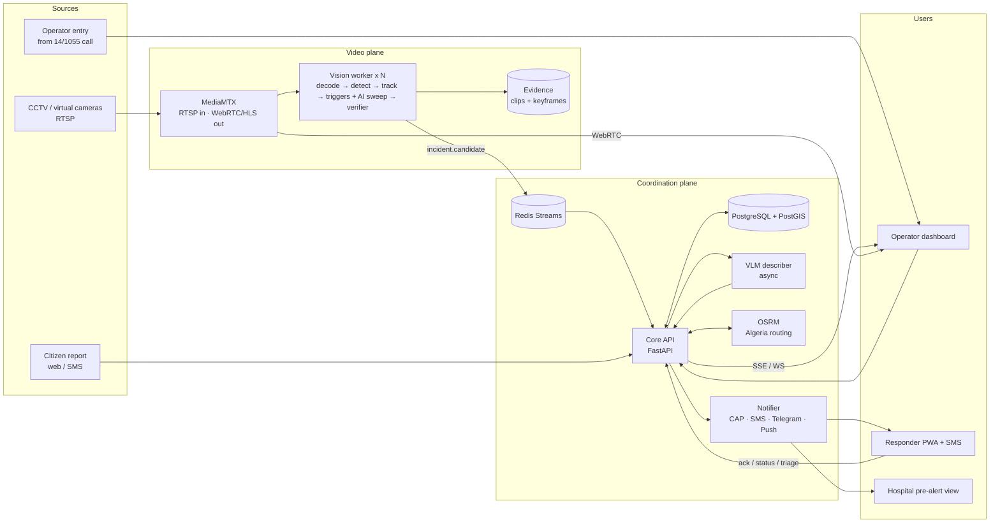
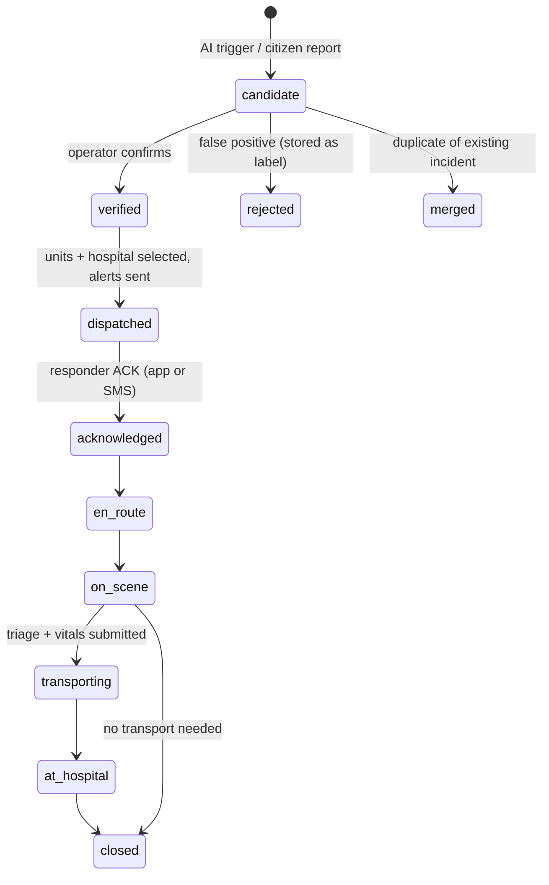
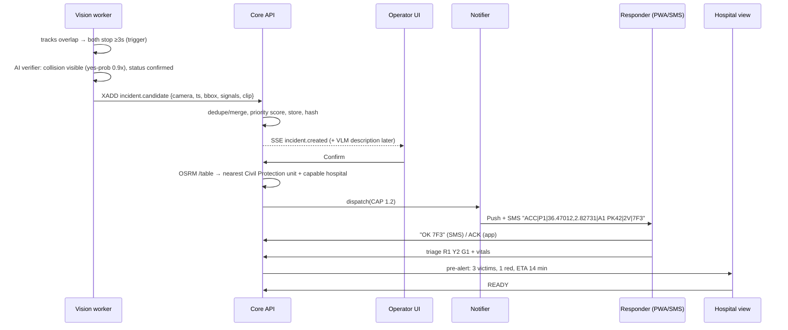

# 05 — Architecture and Technology Stack

## 1. Principles

1. **Modular monolith + workers.** We run one API service, one vision worker per camera, and a VLM worker. There are no per-feature microservices.
2. **Contracts first.** Every component speaks through schemas versioned in `contracts/`:
   - OpenAPI for the API
   - JSON Schema for events
   - a CAP 1.2 profile for alerts
3. **Sovereign by design.** No component requires a foreign cloud. It runs on-premises or in the national data centre.
4. **Video stays local; metadata travels.** Only incident metadata, keyframes and short clips leave the video network.
5. **Human in the loop.** The AI proposes, the operator confirms, and only then are agencies dispatched.

## 2. End-to-end workflow



### Incident lifecycle (state machine)



Every transition writes an `incident_event` row: actor, timestamp, payload, and a link in the hash chain. These rows give us the KPI timeline and the audit trail.

### Sequence: video crash to hospital



## 3. Components

| Component | Responsibility | Tech |
|---|---|---|
| **camsim** | Plays real video files as RTSP cameras. Injects faults (freeze, outage). | MediaMTX v1.21.x, ffmpeg, a small Python CLI |
| **vision worker** (1 process per camera) | Decode, detect, track, measure relative speed, run triggers and the AI sweep, keep the evidence ring buffer, call the verifier, validate its output. Publishes candidates and overlay data. | Python 3.12, PyAV, RF-DETR, supervision; Qwen3-VL-8B on vLLM (GPU host) |
| **vlm worker** | Describes incidents from keyframes. Returns constrained JSON. | Ollama or mlx-vlm, Qwen2.5-VL-7B / Qwen3-VL-8B |
| **core API** | Auth/RBAC, cameras, incidents, merge and dedupe, priority, dispatch, facilities, triage, CAP export, KPIs, audit, SSE/WS. | FastAPI, SQLAlchemy 2 + Alembic (or SQLModel), Pydantic v2 |
| **notifier** (module inside the API, run in a worker) | Fans out to SMS (Android gateway), Telegram, Web Push and email. Handles retries, delivery receipts and inbound SMS parsing. | httpx, python-telegram-bot, pywebpush |
| **database** | Incidents, events, cameras, facilities, units, users, audit. | PostgreSQL 17 + PostGIS |
| **bus** | Candidates from workers, notification jobs, overlay pub/sub. | Redis 8 (Streams + Pub/Sub) |
| **routing** | ETA matrix and route polylines. | OSRM (Geofabrik `algeria-latest.osm.pbf`, MLD) |
| **web** | Operator dashboard, responder PWA, hospital view, citizen report page, analytics. | Next.js (App Router) or Vite + React, TypeScript, shadcn/ui, TanStack Query, MapLibre GL + PMTiles, i18n (ar/fr/en, RTL) |
| **proxy** | TLS and routing. | Caddy |

### Why these choices (alternatives considered)

| Decision | Chosen | Rejected | Reason |
|---|---|---|---|
| API language | **Python / FastAPI** | NestJS, Go | Same language and Pydantic models as the AI workers. Native SSE/WS. Agents generate it well. |
| Video server | **MediaMTX** | go2rtc, GStreamer | One binary for RTSP in plus WebRTC/HLS out, `runOnInit` publishers, and an API. |
| Frame reading | **PyAV** | OpenCV VideoCapture | Packet access for evidence clips without re-encoding, timeouts, and reconnect control. |
| Bus | **Redis Streams** | Kafka, NATS, in-process | Persistence and replay for candidates with a tiny ops footprint. NATS is fine but adds nothing here. |
| DB | **Postgres + PostGIS** | SQLite, TimescaleDB | Geospatial KNN and geofences. Time-series scale is not needed. |
| Browser video | **WebRTC (WHEP)** + canvas overlay | WebCodecs over WebSocket, HLS | About 300 ms latency with no custom decoder. HLS is a fallback. |
| Map | **MapLibre + PMTiles offline** | Google Maps, OSM public tiles | Sovereign and offline; Arabic and French labels. |
| Routing | **OSRM** | Valhalla, GraphHopper, Google | Fastest and simplest for car ETA. Valhalla is the next step for isochrones. |
| SMS | **Android SMS gateway (capcom6)** | Twilio | Twilio Algeria has no two-way SMS and Mobilis blocks numeric sender IDs [V]. The gateway gives real two-way SMS with a local SIM. Production uses an operator business SMS API. |
| Alert format | **CAP 1.2** | custom JSON | OASIS/ITU-T X.1303 standard used by civil-protection and alerting systems. |
| Evidence storage | Local volume + SHA-256 | MinIO | The MinIO community repo is archived [V]. Keep it behind a storage interface (Garage/SeaweedFS later). |
| Auth | JWT + RBAC (FastAPI); Keycloak optional | SAML | Enough for the demo. Keycloak/OIDC is the production story. |

## 4. Data model (core tables)

```
cameras(id, name, rtsp_url, geom Point, road, pk_km, heading_deg, wilaya, zones jsonb, calibration jsonb, status)
incidents(id, short_code, type, status, priority, priority_reasons jsonb, geom Point, road, pk_km, wilaya,
          source[camera|citizen|operator], camera_id, detected_at, event_time, confidence jsonb,
          ai_description jsonb, merged_into, created_at)
incident_events(id, incident_id, kind, actor_id, payload jsonb, ts, prev_hash, hash)   -- append-only
evidence(id, incident_id, kind[clip|keyframe|citizen_photo], path, sha256, start_ts, end_ts)
facilities(id, kind[hospital|civil_protection|gendarmerie|police], name, geom, wilaya, capabilities jsonb, contact_sms)
units(id, facility_id, agency, callsign, status, geom, phone)
dispatches(id, incident_id, unit_id, hospital_id, eta_s, route geojson, status, ts...)
casualties(id, incident_id, triage_tag, avpu, resp_rate, pulse, spo2, notes, reported_by, ts)
notifications(id, incident_id, channel, recipient, payload, status, attempts, provider_ref, ts)
users(id, name, role, agency, facility_id)      audit_log(id, actor, action, target, ts, ip, prev_hash, hash)
```

## 5. Real-time channels

| Flow | Transport |
|---|---|
| Vision worker → API | Redis Stream `incidents.candidates` (consumer group) |
| Detection overlays → browser | Redis Pub/Sub `overlay.<cam>` → API WebSocket `/ws/overlay/{cam}` (≤ 10 Hz, compact JSON) |
| Incident and dispatch updates → dashboards | SSE `/events` (auto-reconnect), filtered by the user's role and agency |
| Responders | Web Push + SMS; PWA polls/SSE when online; offline queue in IndexedDB |

## 6. Security (prototype level, production-minded)

- **RBAC** with roles `operator`, `supervisor`, `responder:<agency>`, `hospital:<id>`, `auditor` and `admin`. Each responder sees only incidents assigned to their agency.
- **Audit:**
  - Append-only `audit_log` and `incident_events`.
  - The DB role has no UPDATE/DELETE on these tables.
  - Evidence *views* are logged too.
- **Evidence integrity:** SHA-256 per file, a hash chain, an Ed25519-signed chain head, and `GET /incidents/{id}/verify`.
- **Transport:** Caddy TLS (`tls internal` on the LAN). MediaMTX authentication is delegated to the API (`authHTTPAddress`).
- **Privacy:**
  - Store clips, not continuous recordings.
  - Retention is configurable (default 90 days, maximum 1 year).
  - Optional face and plate blur on export.
  - A records-of-processing export for the DPO (Law 25-11).
- **Secrets** live in `.env` and are never committed.

## 7. Deployment options for Algeria

| Option | Description | Pros | Cons |
|---|---|---|---|
| **A. Fully centralised** (national data centre) | All streams go over fibre/VPN to the national data centre | One place to operate | Heavy bandwidth; puts video on the wide-area network, against the ANPDP no-internet guidance; single point of failure |
| **B. Per-wilaya on-prem** | Each wilaya surveillance centre runs the full stack | Video never leaves the closed network; matches Decree 15-228 (wilaya centres) | No national picture; duplicated operations |
| **C. Hybrid (recommended)** | **Vision + video in each wilaya/highway control centre** (a GPU server, not edge boxes). **Coordination plane (API, DB, notifier, dashboards) central** in the national data centre, receiving only metadata + evidence clips over the government network | Video stays local; national KPIs; agencies share one incident picture; degrades gracefully (a wilaya node buffers when the link is down) | Two tiers to operate |

**Hackathon:** everything on one laptop.
- `docker compose` runs postgis, redis, osrm, api, web and caddy.
- **MediaMTX and the vision workers run natively on macOS**, so they can use CoreML/Metal and avoid WebRTC NAT problems inside Docker.

## 8. Technology stack summary

| Layer | Choice (versions checked 2026-10-29) |
|---|---|
| Camera simulation | MediaMTX v1.21.3, ffmpeg 7.x |
| Video I/O | PyAV 19.x |
| Detection | Ultralytics YOLO11s (CoreML export) → RF-DETR (Apache-2.0) for production |
| Tracking / zones / speed | supervision (ByteTrack, PolygonZone); speed relative to box size |
| AI verifier + sweep | Qwen3-VL-8B-Instruct-FP8 on vLLM (no training) |
| VLM | Qwen2.5-VL-7B or Qwen3-VL-8B via Ollama or mlx-vlm |
| API | FastAPI 0.16x, Pydantic v2, SQLAlchemy 2, Alembic |
| DB / bus | PostgreSQL 17 + PostGIS 3.5, Redis 8 |
| Routing | OSRM v26.x + Geofabrik Algeria extract; facilities from Overpass + seeded CSV |
| Frontend | React + TypeScript, shadcn/ui, TanStack Query, MapLibre GL v6 + PMTiles, i18next (ar/fr/en) |
| Notifications | capcom6 SMS Gateway for Android, Telegram Bot API, Web Push (VAPID), Mailpit (dev) |
| Alert standard | OASIS CAP 1.2 |
| Infra | Docker Compose, Caddy, `just` (task runner) |

Note: the routing and SMS figures above come from the research agents' checks of GitHub releases and Twilio's Algeria page. Re-check them before installing.
